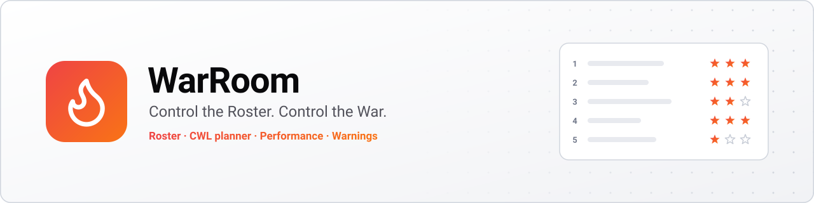
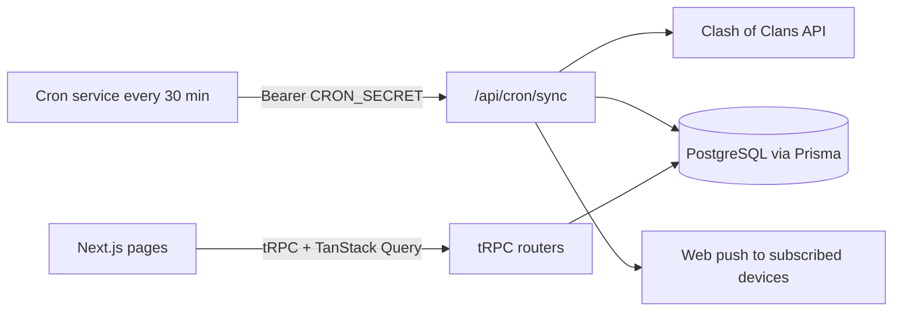

<div align="center">
  <picture>
    <source width="100%" media="(prefers-color-scheme: dark)" srcset="assets/banner-dark.svg" />
    
  </picture>

  <br />
  <br />

<a href="https://nextjs.org/"></a>
<a href="https://react.dev/"></a>
<a href="https://www.typescriptlang.org/"></a>
<a href="https://trpc.io/"></a>
<a href="https://www.prisma.io/"></a>
<a href="https://www.postgresql.org/"></a>
<a href="https://tailwindcss.com/"></a>
<a href="#features"></a>

  <br />
  <br />

  <p align="center">
    <strong>WarRoom &bull; by FireNova</strong><br>
    The dashboard the FireNova Clash of Clans clan uses to run its roster, wars, Clan War League lineups and warnings.
  </p>

  <p align="center">
    <a href="#about">About</a> &bull;
    <a href="#features">Features</a> &bull;
    <a href="#architecture">Architecture</a> &bull;
    <a href="#local-setup">Local setup</a> &bull;
    <a href="#environment-variables">Environment</a> &bull;
    <a href="#access-lock">Access lock</a> &bull;
    <a href="#deployment">Deployment</a> &bull;
    <a href="#tests">Tests</a> &bull;
    <a href="#authors">Authors</a>
  </p>

  <br />
</div>

---

## About

WarRoom is the dashboard my Clash of Clans clan, FireNova, uses to run itself. It tracks the roster, war performance, raid weekends, clan games, Clan War League lineups, warnings and activity, and replaces the spreadsheets and Discord threads we used before. Data comes from the official game API on a schedule, so the dashboard is current even when nobody has it open.

---

## Features

- **Dashboard:** overview cards, the current war (or the last completed war between wars) and an activity feed.
- **Roster:** every member with filtering, sorting and a detail sheet per player. Import from CSV or Excel and export to Excel.
- **CWL planner:** a drag and drop builder for the 15 player lineup, built with dnd-kit.
- **Performance:** three views.
  - **Wars:** per player war stats accumulated across all completed wars.
  - **Raid Weekends:** per player Clan Capital raid results for each raid weekend.
  - **Clan Games:** per player points for each monthly Clan Games event. The game API has no clan games endpoint, so points come from daily snapshots of each member's "Games Champion" achievement. A member shows "-" until a baseline snapshot exists.
- **Warnings:** a dated log of every warning, with push notifications when a warning expires. Issuing a warning from the player details sheet asks for confirmation first, and a warning issued by mistake can be removed from the same sheet.
- **Activity:** the clan event log (joins, promotions, warnings, notes and removals).
- **Access lock (optional):** when switched on, everyone can view, and only the Leader and Co-Leaders can change data after signing in. See [Access lock](#access-lock).
- **Scheduled sync:** an external cron service calls a secret protected route every 30 minutes to pull fresh data and send due notifications. The app also syncs when it is opened and the data is older than 10 minutes.
- **Installable:** web app manifest and web push. The TanStack Query cache is persisted, so pages open with the last known data. The cache is cleared automatically on every new build.

---

## Architecture



Seven tRPC routers (auth, cwl, dashboard, events, performance, roster, sync) are merged into one app router and sit on a Prisma schema of 12 models. Live war state lives in `War`, which is replaced on every sync; when a war ends, a permanent `WarRecord` stores the scores and each member's participation.

### Stack

| Layer | Tools |
| :--- | :--- |
| App | Next.js 16 (App Router), React 19, TypeScript, Tailwind CSS v4, next-themes |
| API | tRPC v11, Zod, superjson |
| Data | Prisma 7, PostgreSQL |
| Client state | TanStack Query with a persisted cache, TanStack Table |
| Other | dnd-kit, web-push, ExcelJS, Papa Parse, Vitest |
| Hosting | Any host that runs Node.js 20.19+ |

---

## Local setup

Requirements: Node.js 20.19+, pnpm 10 (the exact version is pinned in `package.json`, so `corepack enable` picks it up), a PostgreSQL database and a token from [developer.clashofclans.com](https://developer.clashofclans.com).

```bash
pnpm install                    # also runs prisma generate
cp .env.example .env            # fill in the variables below
pnpm exec prisma migrate dev    # local or development database only
pnpm exec prisma db seed        # optional: seed from live game data
pnpm dev                        # http://localhost:3000
```

Use `.env`, not `.env.local`: `prisma.config.ts` and `prisma/seed.ts` load variables with `dotenv/config`, which reads only `.env`. Next.js reads `.env` as well.

To trigger a sync by hand:

```bash
curl -H "Authorization: Bearer <CRON_SECRET>" http://localhost:3000/api/cron/sync
```

---

## Environment variables

| Variable | Purpose |
| :--- | :--- |
| `DATABASE_URL` | Postgres connection string. A pooled URL is fine for the running app |
| `COC_API_TOKEN` | Token from developer.clashofclans.com |
| `COC_CLAN_TAG` | Clan tag, for example `#ABC123` |
| `COC_API_BASE_URL` | Optional. Defaults to the community proxy `https://cocproxy.royaleapi.dev/v1`, which avoids the official API's IP allow list on hosts without a fixed IP. When using the proxy, add `45.79.218.79` to the allowed IPs of your developer key. On a fixed IP, use `https://api.clashofclans.com/v1` and allow your own IP instead |
| `CRON_SECRET` | Must match the `Authorization: Bearer` header sent by the cron service |
| `NEXT_PUBLIC_VAPID_PUBLIC_KEY`, `VAPID_PRIVATE_KEY` | Web push keys, from `npx web-push generate-vapid-keys` |
| `VAPID_EMAIL` | Contact for push, for example `mailto:you@example.com` |
| `ACCESS_LOCK` | Optional. Set to `on` to turn on the access lock. Any other value, or leaving it unset, keeps the app open to everyone |
| `SESSION_SECRET` | Required when the lock is on. A random string of at least 32 characters used to sign the session cookie |

---

## Access lock

By default anyone with the link can view and edit. With the lock on, viewers still see everything, read only, and only the clan's current Leader and Co-Leaders can make changes.

**Turning it on**

1. Generate a secret: `openssl rand -hex 32` (or `node -e "console.log(require('crypto').randomBytes(32).toString('hex'))"`).
2. Set `SESSION_SECRET` to that value and `ACCESS_LOCK=on`, then restart or redeploy.

**Signing in**

The Leader or a Co-Leader taps Sign in and enters their player tag and their in game API token (in Clash of Clans: Settings, More Settings, API Token). The token is checked once with Supercell through the configured CoC API base URL and is never stored or logged. A signed session cookie then keeps them signed in for 30 days. No Supercell ID, email or password is ever asked for. Sign-in attempts are rate limited (per player tag and IP) to protect the Clash of Clans API quota from automated spam.

**Losing access**

- Roles are checked against the synced roster on every change, so a member who is demoted in game, leaves or is removed loses edit access after the next sync.
- To sign everyone out at once, replace `SESSION_SECRET` with a new value and redeploy.

The cookie is marked `Secure` in production, so the site must be served over HTTPS when the lock is on. Otherwise the browser drops the cookie and sign in appears to do nothing.

---

## Deployment

WarRoom is a standard Next.js app and runs on any host that runs Node.js 20.19+, for example Vercel, Netlify, Railway, Render, Docker or a VPS.

1. **Build and start:**

   ```bash
   pnpm install
   pnpm build
   pnpm start
   ```

   Managed hosts usually detect these commands on their own.

2. **Environment:** set the variables from [Environment variables](#environment-variables) in the host's settings. Serve the site over HTTPS: the sign in cookie and web push both require it.

3. **Migrations:** the build does not run migrations. Before deploying a change that adds a migration, run `pnpm run migrate` (`prisma migrate deploy`) against a direct, non pooled database URL. Pooled connections can fail with an advisory lock timeout. With Prisma Postgres, for example, use the same URL with the host `pooled.db.prisma.io` changed to `db.prisma.io`.

   ```powershell
   # PowerShell
   $env:DATABASE_URL = "<direct url>"; pnpm run migrate
   ```

   ```bash
   # bash
   DATABASE_URL="<direct url>" pnpm run migrate
   ```

   > **Warning:** never point `prisma migrate dev` at the live database. It can reset the database and delete all data. Use `pnpm run migrate` for production.

4. **Scheduled sync:** create a job on any cron service ([cron-job.org](https://cron-job.org) works well) that calls `GET https://<your-domain>/api/cron/sync` every 30 minutes with the header `Authorization: Bearer <CRON_SECRET>`. Turn on failure notifications if the service offers them.

5. **Clash of Clans API:** hosts with a fixed outbound IP may set `COC_API_BASE_URL` to the official `https://api.clashofclans.com/v1` and allow that IP on the developer key. All other hosts keep the default proxy.

6. **Members on iOS** install the app to the home screen before the notification prompt appears.

---

## Tests

```bash
pnpm test
```

24 Vitest files of unit tests (no database) cover war result mapping, raid and clan games calculations, performance stats, CSV import and export, validation, roster filtering, warning removal, push payload building, sync timing, the persisted cache, and the access lock (session signing, sign in decisions, rate limiting, and edit rights).

---

## Fan content notice

This material is unofficial and is not endorsed by Supercell. For more information see Supercell's Fan Content Policy: [https://www.supercell.com/fan-content-policy](https://www.supercell.com/fan-content-policy)

---

## Authors

WarRoom is created and maintained by:

<br />

<div align="center">
  <table>
    <tr>
      <td align="center" width="220">
        <a href="https://github.com/AmithShankar">
          <br /><br />
          <b>Amith Shankar</b>
        </a><br />
        <sub>Creator</sub><br /><br />
        <a href="https://github.com/AmithShankar"><code>@AmithShankar</code></a>
      </td>
    </tr>
  </table>
</div>

<br />

No license file is included. All rights reserved.
